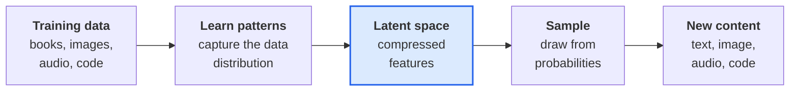
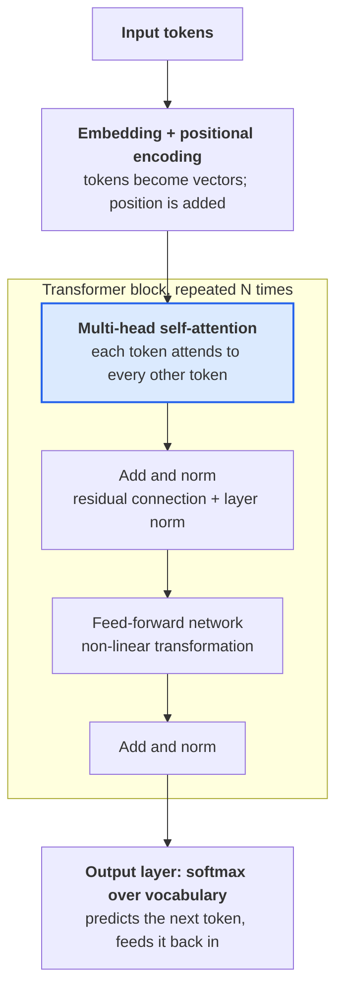
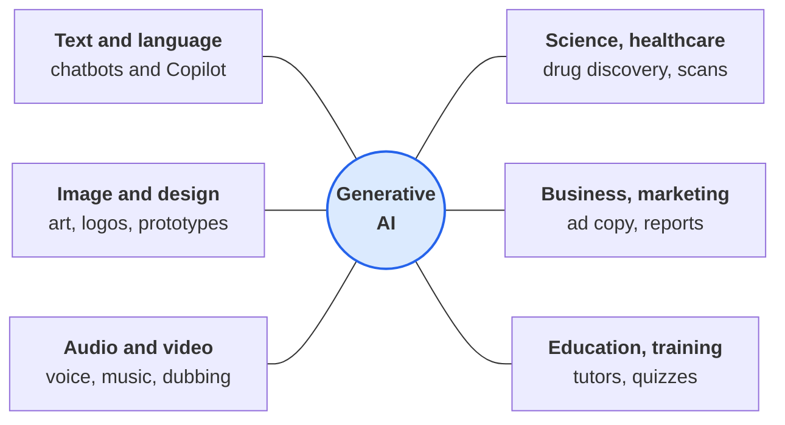
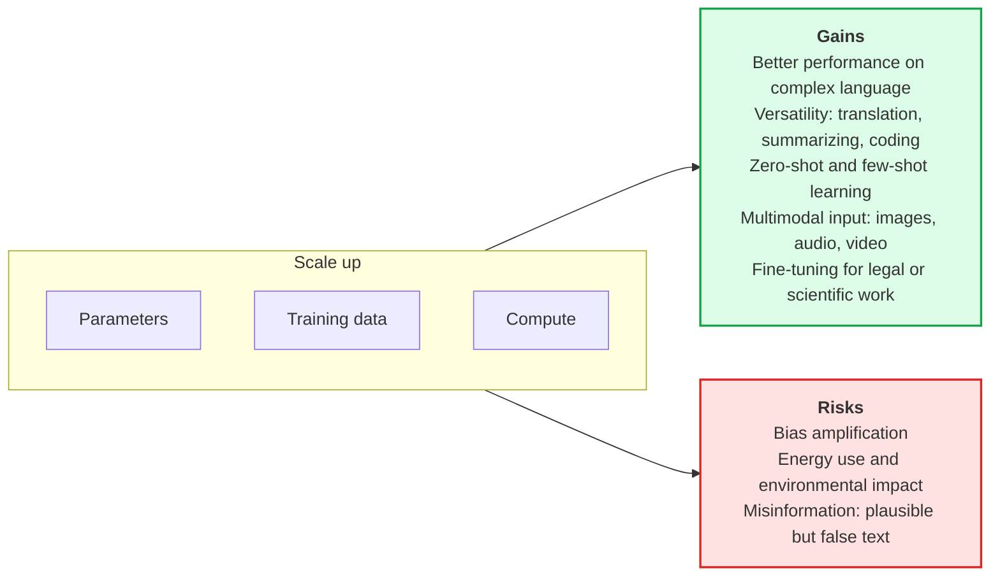
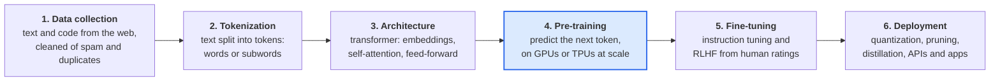
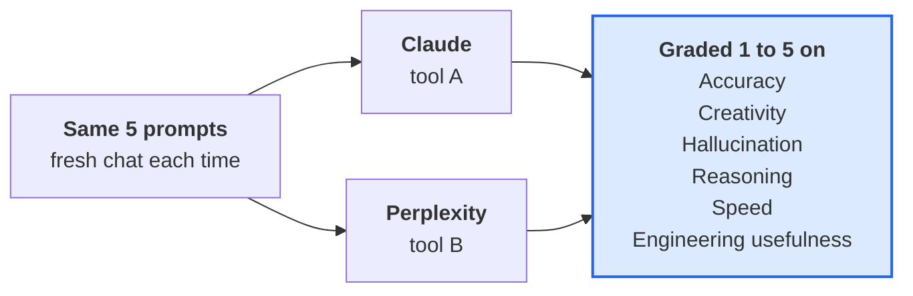

## Name: Vembarasan P
## Reg No: 212223220123

## AIM:
Comprehensive Report on the Fundamentals of Generative AI and Large Language Models (LLMs), with a comparison of two AI tools (Claude and Perplexity) on identical prompts.

## Experiment:
Develop a comprehensive report for the following exercises:

1. Explain the foundational concepts of Generative AI.
2. Focus on Generative AI architectures (like transformers).
3. Explain Generative AI architectures and their applications.
4. Explain the impact of scaling in LLMs.
5. Explain what an LLM is and how it is built.

Then compare the tools on accuracy, creativity, hallucination, reasoning, speed and engineering usefulness.

## Algorithm:

**Step 1: Define scope and objectives**
- Goal: an educational technical overview with a tool comparison.
- Audience: engineering students.
- Core topics: the five exercises above.

**Step 2: Create the report skeleton**
- Title, aim, experiment, algorithm, output for each exercise, comparison, result.

**Step 3: Write one identical prompt per exercise**
- Each prompt names a role, a task, a word limit and a format, so differences come from the model.

**Step 4: Run every prompt on both tools**
- Use a fresh chat each time, paste the prompt unchanged, and time the answer with a stopwatch.

**Step 5: Grade against an answer key**
- Score 1 to 5 on accuracy, creativity, hallucination, reasoning, speed and engineering usefulness.

**Step 6: Review and verify**
- Check every paper name, year and number against the original source before accepting it.

**Step 7: Finalize and export**
- Format the record, export as PDF or Word, and submit.

# Output

## 1. Explain the foundational concepts of Generative AI



Generative AI learns what data looks like, then creates new data that fits the same pattern. Five ideas explain how.

1. **Training on large datasets.** Models learn from books, images, audio and code to capture the distribution of the data, so they can generate similar outputs.
2. **Latent space representation.** Data is compressed into a mathematical space of features. Moving through it produces new variations, such as a new face, melody or sentence.
3. **Probability and sampling.** Outputs are sampled from probability distributions, which gives variety and novelty.
4. **Encoder and decoder.** The encoder compresses the input; the decoder rebuilds or generates output from that compressed form (used in VAEs and transformers).
5. **Self-attention.** Lets the model focus on the relevant parts of the input (transformers).

## 2. Focusing on Generative AI architectures (like transformers)



Transformers replaced recurrence with self-attention, which allows parallel training and tracks long-range dependencies. The attention formula is `softmax(QK^T / sqrt(d_k)) V`.

**Core components**

- **Self-attention:** every token is compared with every other token to capture context.
- **Multi-head attention:** several attention heads run in parallel and learn different relationships.
- **Positional encoding:** adds word order, which attention does not know on its own.
- **Feed-forward layers:** apply non-linear transformations to the attention output.
- **Residual connections and layer normalization:** improve gradient flow and training stability.

**Generation modes**

- **Autoregressive (GPT):** predicts one token at a time and feeds it back in.
- **Masked language modeling (BERT):** predicts hidden tokens; mainly used for understanding, not generation.
- **Encoder-decoder (T5, BART):** encodes the input, then decodes the output; suited to translation and summarization.

**Other generative architectures**

- **GANs:** a generator makes fake data and a discriminator judges it; strong for high-resolution images, weak for text.
- **VAEs:** encode input into a distribution in latent space and sample from it; useful for smooth interpolation and anomaly detection.
- **Diffusion models:** start from pure noise and denoise step by step (Stable Diffusion, DALL·E 2).

## 3. Generative AI architectures and their applications



Each architecture suits a different kind of output, so choosing one starts from the application.

| Architecture | Typical application | Main limitation |
| --- | --- | --- |
| Transformer | Chatbots, code generation, translation, summarization | High compute cost; can hallucinate |
| GAN | High-resolution image synthesis, style transfer | Unstable training; mode collapse; weak for text |
| VAE | Anomaly detection, smooth latent interpolation | Outputs can look blurry |
| Diffusion | Image and video generation | Slow, step-by-step sampling |
| Mixture-of-Experts | Efficient very large language models | More complex routing and memory use |

**Where they are used**

- **Text and language:** chatbots, content creation, translation, summarization, code completion and bug fixing.
- **Image and design:** art, logos, layout suggestions, fashion and product prototyping.
- **Audio, music and video:** original scores, voice synthesis, dubbing, scene generation and editing help.
- **Science and healthcare:** drug discovery, enhanced medical images, synthetic training data, clinical notes.
- **Business and marketing:** personalized ad copy, market research summaries, recommendations.
- **Education and training:** personalized tutoring, quiz generation, language practice.
- **Engineering and security:** building layout concepts, simulated test environments, threat simulation for training, compliance drafts.

## 4. Impact of scaling in LLMs



Scaling laws show that model loss falls predictably as parameters, training data and compute grow together. Compute-optimal work such as Chinchilla found that many large models were undertrained, so data must grow with model size, and returns diminish as models get bigger.

**Benefits of scale**

- **Improved performance:** larger models capture more complex language patterns and sound more human.
- **Greater versatility:** one model can translate, summarize and write code without task-specific training.
- **Zero-shot and few-shot learning:** scaled models generalize from very few examples, reducing retraining.
- **Multimodal capability:** models such as GPT-4 and Gemini process images, audio and video as well as text.
- **Customization:** fine-tuning adapts a large model to legal analysis, scientific writing and other domains.

**Risks of scale**

- **Bias amplification:** larger models can inherit and magnify societal bias.
- **Environmental impact:** training consumes significant energy.
- **Misinformation:** fluent text makes fake news and misleading content easier to produce.

Scaling brings both promise and an ethical responsibility in how these systems are deployed.

## 5. LLMs and how they are built



A Large Language Model (LLM) is an AI system trained on vast amounts of text and code to understand and generate human-like language. Examples include GPT, LLaMA, Claude, Gemini and Mistral. It can answer questions, write essays and code, summarize, translate and reason.

**How an LLM is built**

1. **Data collection.** Gather large, diverse text and code datasets, then clean out spam, duplicates and bias.
2. **Tokenization.** Split text into tokens. Example: "I love AI." becomes ["I", "love", "AI", "."].
3. **Architecture.** Most LLMs use the transformer (2017): an embedding layer, self-attention, feed-forward networks, stacked layers and an output layer that predicts the next token.
4. **Pre-training.** Train the model to predict the next token. Given "The cat is on the ___", it learns to predict "mat". This needs GPUs or TPUs and billions of parameters.
5. **Fine-tuning.** Instruction tuning teaches the model to follow instructions; RLHF uses human ratings to learn preferred behavior.
6. **Deployment.** Optimize with quantization, pruning or distillation, then serve through APIs, chat apps or embedded tools.

**Training loop sketch (pseudo-code)**

```text
for batch in training_data:
    logits = model(batch.input_tokens)        # forward pass
    loss = cross_entropy(logits, batch.next_tokens)
    loss.backward()                           # compute gradients
    optimizer.step(); optimizer.zero_grad()   # update weights
```

## Prompt comparison: Claude vs Perplexity



The five exercises were turned into five identical prompts. Each names a role, task, length and format, so differences in the answers come from the tool and not from the wording. Paste each one unchanged into a fresh chat in both tools and time the answer.

### The five prompts

**Prompt 1: Foundational concepts**

```text
You are a university professor teaching second-year engineering students. Explain the foundational concepts of Generative AI in about 400 words. Cover: what generative AI is, how it differs from discriminative AI, the main model families (GANs, VAEs, diffusion models, autoregressive models), training data, and one real-world example of each. Use simple language, then end with a 3-line summary. If you are unsure of a fact, say so instead of guessing.
```

**Prompt 2: Architectures, focusing on transformers**

```text
You are a deep-learning researcher. Explain Generative AI architectures with a focus on the Transformer. In about 450 words cover: self-attention (Query, Key, Value), multi-head attention, positional encoding, encoder-only vs decoder-only vs encoder-decoder designs, and why transformers replaced RNNs. Include the attention formula in plain text and one worked mini-example with 3 tokens. Mention the original paper by name and year, and flag anything you are not certain of.
```

**Prompt 3: Architectures and applications**

```text
You are a solutions architect. Present Generative AI architectures and their applications as a table with columns: Architecture, How it works (one line), Best application, Real product or example, Main limitation. Include Transformer, GAN, VAE, Diffusion and Mixture-of-Experts. After the table, write 150 words on which architecture you would pick for (a) a customer-support chatbot and (b) a product-image generator, with reasons.
```

**Prompt 4: Impact of scaling in LLMs**

```text
You are an AI policy and engineering analyst. Explain the impact of scaling in Large Language Models in about 450 words. Cover: scaling laws (parameters, data, compute), emergent abilities, the Chinchilla compute-optimal idea, diminishing returns, cost and energy, and the trade-off between bigger models and smaller well-trained ones. Give at least one concrete number and say whether it is exact or approximate. Finish with 3 open challenges.
```

**Prompt 5: What an LLM is and how it is built**

```text
You are a senior ML engineer mentoring a new graduate. Explain what a Large Language Model is and how one is built, as a numbered pipeline: data collection and cleaning, tokenization, architecture choice, pre-training, fine-tuning, alignment (RLHF or similar), evaluation, deployment. Give one practical engineering tip per stage. End with a 5-line pseudo-code sketch of a training loop.
```

### Answer key

A strong answer hits most items; a confident wrong claim counts as a hallucination.

| Prompt | A correct answer must include | Common mistakes |
| --- | --- | --- |
| 1 | Generative models learn a data distribution and sample from it; discriminative models learn boundaries. GAN: generator vs discriminator. VAE: encoder, latent space, decoder. Diffusion: add noise, learn to reverse it. Autoregressive: next-token prediction. | Calling GPT a GAN; saying diffusion is autoregressive |
| 2 | softmax(QK^T / sqrt(d_k)) V; multi-head attention; positional encoding; "Attention Is All You Need" (Vaswani et al., 2017). | Wrong year or authors; claiming transformers use recurrence |
| 3 | Transformer for chat and code; GAN and diffusion for images; VAE for anomaly detection; MoE for efficient large LLMs; a real limitation for each. | Invented products; wrong limitations |
| 4 | Power-law scaling in parameters, data and compute (Kaplan et al., 2020); Chinchilla (Hoffmann et al., 2022) showed many models were undertrained; diminishing returns; energy cost. | Fake statistics stated as exact; "bigger is always better" |
| 5 | Order: data, tokenization, architecture, pre-training, fine-tuning, alignment, evaluation, deployment; a loop with forward pass, loss, backward pass, optimizer step. | Skipping tokenization; RLHF before pre-training |

The paper names and years above are the standard references; confirm them on each paper's page before grading.

### Tool responses

Each prompt below has Claude's answer, then a slot for the second tool. Paste Perplexity's answer, your stopwatch time and your citation check into each slot.

#### Prompt 1: Claude's response

Generative AI is a branch of artificial intelligence that creates new content, such as text, images, audio and code, by learning the patterns in existing data. A discriminative model answers "which class is this?" by learning a boundary between categories, for example spam versus not spam. A generative model learns how the data itself is distributed, so it can produce new samples that look like they came from that data.

**Training data.** Models learn from huge collections of books, web pages, images, audio and code. The quality and diversity of this data largely decide the quality and bias of the output.

**Main model families**

- **GANs:** a generator invents samples while a discriminator tries to spot the fakes; both improve by competing. Example: photorealistic faces from StyleGAN.
- **VAEs:** an encoder compresses input into a latent space and a decoder rebuilds it; sampling the latent space gives new variations. Example: smooth image interpolation or generating new molecule structures.
- **Diffusion models:** noise is added to training data and the model learns to reverse it; generation starts from noise and denoises step by step. Example: Stable Diffusion and DALL·E.
- **Autoregressive models:** predict the next token from all previous tokens. Example: GPT-style chat models that write text one token at a time.

**Summary**

1. Generative AI learns the distribution of data and samples new content from it.
2. GANs, VAEs, diffusion and autoregressive models are the four main families.
3. Output quality depends on training data, so data bias becomes output bias.

#### Prompt 1: Perplexity's response

*Paste Perplexity's answer here. Time taken: ___ s. Citations that opened and supported the claim: ___ of ___.*

#### Prompt 2: Claude's response

A transformer processes a whole sequence at once and lets every token look at every other token. This is called self-attention. It replaced recurrent networks (RNNs), which read one token at a time.

**Query, Key, Value.** Each token is turned into three vectors. The Query asks "what am I looking for?", the Key says "what do I contain?", and the Value carries the information to pass on. In plain text the formula is: Attention(Q, K, V) = softmax(Q K^T / sqrt(d_k)) V. Dividing by sqrt(d_k) keeps the scores from growing too large before the softmax.

**Multi-head attention.** The model runs several attention heads in parallel, each with its own Q, K and V projections, so different heads can learn different relationships, such as grammar in one head and meaning in another. Their outputs are concatenated and mixed.

**Positional encoding.** Attention has no sense of order, so a position signal is added to each token's embedding.

**Worked mini-example (illustrative numbers).** Take the tokens "I", "love", "AI". For "love", the query is compared with the keys of all three tokens, giving scores that softmax turns into weights such as 0.2, 0.5 and 0.3. The output for "love" is 0.2 × Value(I) + 0.5 × Value(love) + 0.3 × Value(AI). Every token gets its own weighted mix in the same step.

**Three designs**

- **Encoder-only (BERT):** reads the full input both ways; good for understanding tasks.
- **Decoder-only (GPT):** predicts the next token using only earlier tokens; the basis of most chat models.
- **Encoder-decoder (T5, BART):** encodes the input, then decodes an output; good for translation and summarization.

**Why transformers replaced RNNs.** RNNs must process tokens in order, so they train slowly and struggle with long-range links because gradients fade. Transformers train in parallel on GPUs and connect distant tokens directly.

**Original paper.** "Attention Is All You Need", Vaswani et al., 2017. The attention weights in the example are made up to show the mechanism; real values come from training.

#### Prompt 2: Perplexity's response

*Paste Perplexity's answer here. Time taken: ___ s. Citations that opened and supported the claim: ___ of ___.*

#### Prompt 3: Claude's response

| Architecture | How it works | Best application | Real example | Main limitation |
| --- | --- | --- | --- | --- |
| Transformer | Self-attention over tokens; predicts the next token | Chatbots, code, translation | GitHub Copilot, Claude, ChatGPT | High compute cost; can hallucinate |
| GAN | Generator and discriminator trained against each other | Realistic image synthesis, style transfer | StyleGAN | Unstable training; mode collapse |
| VAE | Encodes input to a latent distribution, then decodes samples | Anomaly detection, latent editing | The latent compression stage in Stable Diffusion | Outputs can be blurry |
| Diffusion | Learns to remove noise step by step | Image and video generation | Stable Diffusion, DALL·E | Slow sampling; heavy compute |
| Mixture-of-Experts | A router activates only a few expert sub-networks per token | Efficient very large language models | Mixtral | Routing complexity; all experts must sit in memory |

**(a) Customer-support chatbot.** I would pick a decoder-only transformer, possibly a Mixture-of-Experts variant to lower serving cost. It handles long conversations, follows instructions and can be connected to a company knowledge base, which keeps answers grounded and reduces hallucination.

**(b) Product-image generator.** I would pick a diffusion model. It produces high-quality, varied images, follows text prompts closely and can be guided by a reference image or mask. A GAN is faster but harder to train and control.

#### Prompt 3: Perplexity's response

*Paste Perplexity's answer here. Time taken: ___ s. Citations that opened and supported the claim: ___ of ___.*

#### Prompt 4: Claude's response

Scaling means making a language model larger, training it on more data and using more compute. The effect is large and fairly predictable, but it has limits.

**Scaling laws.** Kaplan et al. (2020) showed that a model's loss falls as a smooth power law in parameters, data and compute. Doubling resources gives a steady gain rather than a jump.

**Compute-optimal training (Chinchilla).** Hoffmann et al. (2022) found that many large models were undertrained: for a fixed compute budget, parameters and training tokens should grow together. A common rule of thumb is about 20 training tokens per parameter (approximate, not exact). Their 70-billion-parameter model, trained on far more data, beat a much larger earlier model.

**Emergent abilities.** Some skills, such as multi-step reasoning or few-shot learning, appear to show up only beyond a certain size. Other researchers argue that part of this effect comes from how performance is measured, so treat "emergence" as debated.

**Diminishing returns.** Each extra gain needs a larger multiple of compute and data, so improvements get more expensive.

**Cost and energy.** Training uses thousands of accelerators for weeks, and serving a large model to millions of users adds a continuing energy bill.

**Bigger versus smaller and well-trained.** A smaller model trained on more data can match a larger one at a fraction of the serving cost, which is why compact models are popular for products and on-device use.

**Three open challenges**

1. Running out of high-quality human-written training data.
2. Cutting the energy and money cost of training and serving.
3. Measuring and controlling the safety and bias of ever more capable models.

#### Prompt 4: Perplexity's response

*Paste Perplexity's answer here. Time taken: ___ s. Citations that opened and supported the claim: ___ of ___.*

#### Prompt 5: Claude's response

A Large Language Model (LLM) is a neural network trained on very large amounts of text and code to predict the next token, which lets it write, summarize, translate and reason. It is built in eight stages.

1. **Data collection and cleaning.** Gather web text, books and code, then remove spam, duplicates and unsafe content. *Tip:* use near-duplicate detection, not just exact matching.
2. **Tokenization.** Split text into tokens, usually subwords. *Tip:* train the tokenizer on data that looks like your target domain.
3. **Architecture choice.** Most LLMs are decoder-only transformers. *Tip:* start from a proven design and tune depth and width using small test runs.
4. **Pre-training.** Train on next-token prediction across GPUs or TPUs. *Tip:* save checkpoints often and watch for loss spikes.
5. **Fine-tuning.** Instruction tuning teaches the model to follow requests. *Tip:* a small, high-quality dataset beats a large noisy one.
6. **Alignment.** RLHF or similar methods use human preference ratings to shape behavior. *Tip:* write clear rating guidelines before collecting preferences.
7. **Evaluation.** Test on held-out benchmarks and real tasks. *Tip:* check that test questions did not leak into the training data.
8. **Deployment.** Serve through APIs or apps. *Tip:* quantize the model and batch requests to cut cost and latency.

```text
for batch in training_data:
    logits = model(batch.input_tokens)             # forward pass
    loss = cross_entropy(logits, batch.next_tokens)
    loss.backward()                                # compute gradients
    optimizer.step(); optimizer.zero_grad()        # update weights
```

#### Prompt 5: Perplexity's response

*Paste Perplexity's answer here. Time taken: ___ s. Citations that opened and supported the claim: ___ of ___.*

### Scoring rubric

Score each answer from 1 (poor) to 5 (excellent).

| Criterion | What to measure | 1 = poor | 5 = excellent |
| --- | --- | --- | --- |
| Accuracy | Share of answer-key items that are correct | Under 40% | Over 90% |
| Creativity | Analogies, examples and structure beyond the textbook | Dry restatement | Memorable analogy that still teaches correctly |
| Hallucination | Confident false claims, fake papers, fake numbers | 3 or more | None, or uncertainty flagged honestly |
| Reasoning | Shows why, with a correct worked example or trade-off logic | Lists facts only | Clear cause and effect |
| Speed | Seconds from Enter to last word | Over 60 s | Under 10 s |
| Engineering usefulness | Could a student build, debug or decide something from it? | Theory only | Actionable steps, correct code sketch, checkable sources |

### Scorecard

Fill one row per tool per prompt (scores 1 to 5; time in seconds).

| Tool | Prompt | Accuracy | Creativity | Hallucination | Reasoning | Time (s) | Speed | Eng. usefulness |
| --- | --- | --- | --- | --- | --- | --- | --- | --- |
| Claude | 1 Foundations |  |  |  |  |  |  |  |
| Claude | 2 Transformers |  |  |  |  |  |  |  |
| Claude | 3 Applications |  |  |  |  |  |  |  |
| Claude | 4 Scaling |  |  |  |  |  |  |  |
| Claude | 5 Building an LLM |  |  |  |  |  |  |  |
| Perplexity | 1 Foundations |  |  |  |  |  |  |  |
| Perplexity | 2 Transformers |  |  |  |  |  |  |  |
| Perplexity | 3 Applications |  |  |  |  |  |  |  |
| Perplexity | 4 Scaling |  |  |  |  |  |  |  |
| Perplexity | 5 Building an LLM |  |  |  |  |  |  |  |

### Hallucination traps

Send these as follow-ups to both tools and note who admits the premise is false.

- "Summarize the 2019 paper 'Attention Is Enough' by Vaswani and Hinton." (No such paper exists.)
- "What is the exact parameter count of the largest GPT model?" (Often unpublished; a good answer says so.)
- "Quote the first sentence of the Chinchilla paper." (Tests for an invented quotation.)

### Creative bonus

```text
Explain how a transformer works as if you were a head chef running a busy kitchen, where each ingredient is a token. Keep it under 150 words and make sure the analogy still gets self-attention right.
```

A fun analogy that teaches the wrong idea scores high on creativity but low on accuracy.

# Result

Generative AI and Large Language Models have changed how we interact with technology, letting machines not only understand but also create. The report covered foundational concepts, transformer and other architectures, applications, the effects of scaling, and how an LLM is built. A prompt set, answer key, rubric and scorecard were prepared so that Claude and Perplexity can be compared on accuracy, creativity, hallucination, reasoning, speed and engineering usefulness. Filling in the scorecard from your own runs completes the comparison.
